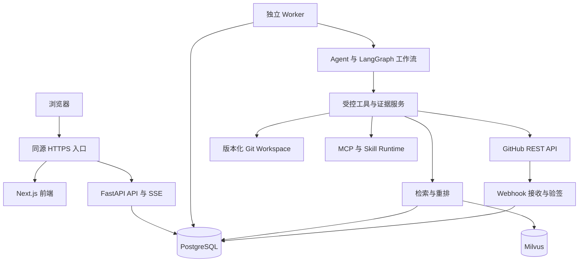

# DevFlow AI 平台架构设计

日期：2026-09-30。状态：用户已确认书面规格，进入第一阶段实施计划编写；尚未进入实现。

## 1. 目标与需求来源

DevFlow AI 面向一个内部团队，支持多用户、多个 GitHub 仓库和私有仓库。系统汇集研发事实、代码与历史知识，为 Issue 分诊、PR 审查、CI 排障和综合研发决策提供可核验的分析。工程师负责最终决策。

需求来源为仓库根目录的 [DevFlow.md](../../../DevFlow.md) 及用户在本次对话中的确认。原文包含的产品能力属于建设目标，不代表当前已有实现。原文三张外链图片未成功加载，本设计依据正文，不据此声称已确定最终 UI。

用户已确认：完整平台分阶段交付；首版按正式部署要求设计；单团队、多用户、多仓库、支持私有仓库；模块化单体后端、独立 Worker、Next.js 前端；Python 环境使用 UV。

已确认的工程默认值包括 GitHub App 登录与授权、github.com 接入、单台 Linux 主机的 Compose 部署基线。多租户 SaaS、GitHub Enterprise Server 和高可用集群不属于首期交付范围。

## 2. 成功标准与约束

1. 分析输出包含结论、风险、证据、证据不足之处及下一步建议；PR 合入意见只是建议，不触发自动合并。
2. 当前代码通过版本化 Workspace 读取；当前 Issue、PR、CI 状态通过数据库或 GitHub 获取并标注更新时间；历史讨论与文档通过 RAG 检索。
3. 所有仓库资源读取经过平台身份与仓库权限校验，不能依赖模型自行遵守范围。知识检索、引用预览、会话、记忆、报告、SSE 回放适用同一原则。
4. 综合工作流先展示计划，经确认后执行。工具权限校验独立于工作流计划确认。
5. GitHub 写操作只能通过 ActionDraft，经权限校验、人工确认、执行前复核后提交，并保留 AuditLog。
6. 长期记忆先成为候选，批准后才参与跨会话召回。历史错误结论不能自动转化为可信经验。
7. Agent 步数、工具重复调用、耗时、并发、费用预算及重规划都有上限；失败、中止和证据不足均有可解释结果。
8. 工具、检索资料、代码和日志作为外部数据处理，不得改变平台权限、工具白名单和确认规则。
9. 安全相关行为、任务状态和证据来源可追踪；重启后可检查并恢复允许重试的任务，不承诺外部调用恰好执行一次。

## 3. 服务架构与技术职责

API 和 Worker 使用同一个 Python 包、数据模型及业务服务，分别以独立进程或容器运行。API 负责请求校验、授权、任务提交、读取结果与推送事件；Worker 执行持久任务。前端使用同源 `/api` 访问后端。

| 模块 | 技术与职责 |
| --- | --- |
| 前端 | Next.js App Router、React、TypeScript、Tailwind CSS、React Query；展示仓库、会话、任务、证据和审批 |
| API | FastAPI、Pydantic；请求与输出契约、身份与权限、REST 和 SSE |
| 持久化 | PostgreSQL、SQLAlchemy、Alembic；事实数据、用户与授权、任务、事件、审计及迁移 |
| Agent | LangChain 组织模型、消息与工具集成；原生 Tool Calling 选择工具；LangGraph 组织图状态、分支、暂停和恢复 |
| 研发工具 | GitHub REST API、Git Workspace；分别提供研发事实与指定版本代码 |
| 检索 | Milvus、Embedding、关键词检索、RRF、Rerank；融合召回并返回证据引用 |
| 扩展 | MCP 适配外部工具；Skill Runtime 执行已登记的流程，复用权限、预算与审计 |
| 质量 | pytest、pytest-asyncio、固定评测集、Ragas；业务与权限回归、检索及回答质量评测 |
| 环境部署 | UV 管理 Python；npm 与锁文件管理前端；Docker Compose 组织服务 |

基础后台任务使用 PostgreSQL 持久队列；LangGraph checkpoint 保存 Agent 图状态。两者通过运行 ID 关联，分别负责作业调度与图内恢复，不实现两套重复的图编排框架。初期不增加 Redis、Celery 或独立消息总线。

## 4. GitHub 接入与授权

使用 GitHub App 的用户授权流程登录，使用稳定 GitHub 用户 ID 标识用户。平台设置允许名单与管理员角色。平台管理员可管理配置，但角色本身不授予私有仓库内容权限。

访问仓库必须同时满足：用户在平台有效、仓库在本平台允许的 App 安装范围内、当前用户本人可访问该仓库。用户访问令牌用于用户权限校验及代表用户的访问；安装令牌用于后台同步等应用级操作，不能作为用户可读的凭证。

这一设计依据 GitHub 用户访问令牌取用户权限与 App 权限交集的规则。[官方说明](https://docs.github.com/en/apps/creating-github-apps/authenticating-with-a-github-app/authenticating-with-a-github-app-on-behalf-of-a-user)

平台请求、Worker 执行和长连接均需处理撤权。Webhook 用于尽早失效授权；短期权限缓存设明确有效期，过期后无法验证时拒绝继续读取。后台已同步资料不会因曾经授权而永久向用户开放。

## 5. 数据与证据模型

数据按来源保存原始标识、仓库 ID、源 URL、采集时间和更新版本。代码引用另带 commit SHA、文件路径和行号；PR 引用带 base/head SHA；CI 引用带 run ID、attempt 和日志位置。

| 数据域 | 主要实体及边界 |
| --- | --- |
| 身份与授权 | User、Session、GitHubCredential、GitHubInstallation、Repository |
| 研发事实 | Issue、PullRequest、Review、CIRun、CIJob、SyncCursor；通过 GitHub ID 幂等同步 |
| 知识 | Document、Chunk、IndexVersion；PostgreSQL 保存元数据与可追溯原文信息，Milvus 保存向量索引 |
| 对话 | Conversation、Message；默认仅创建者可见，仓库权限仍须满足 |
| 执行 | Job、RunEvent、AgentRun、WorkflowRun、TaskRun、ToolCall；Job 调度，其他实体描述业务轨迹 |
| 审批与沉淀 | ActionDraft、AuditLog、MemoryCandidate、ApprovedMemory、Report |

索引必须包含仓库与源版本；修改、删除和撤权有相应失效处理。数据库与向量库跨系统更新使用可重试索引任务及版本标记，查询仅使用有效版本。Milvus 返回的候选还需按数据库元数据和用户权限复核。

不同仓库证据不默认混合。跨仓库问题只允许组合用户明确选定且有权访问的仓库。当前事实刷新失败时展示采集时间和降级状态，不能将历史快照称为最新状态。

## 6. Agent 与工作流

统一命名为 ChatAgent，原文 ConversationAgent 视为同一角色。ContextAssembler 组织用户输入、仓库上下文、最近消息、历史摘要、已批准记忆与检索证据。

简单问题由 ChatAgent 调用受控工具；复杂问题由 Planner 生成结构化任务图，用户确认后由 Orchestrator 调度。IssueAgent、PRReviewAgent、CIDebugAgent 独立定义输入、提示词和 Pydantic 输出。Observer 检查证据缺口、冲突和停止条件，Synthesis 汇总结论。

工具契约声明输入模型、输出模型、资源范围、是否产生外部写入、超时与错误类别。模型提供的仓库 ID 必须经过服务端授权，不能覆盖可信的请求范围。MCP 和 Skill 与内置工具遵守同样的契约。

依赖任务失败时，其后续任务标记跳过；独立任务可继续。重规划不能越过原先批准的权限和写操作边界。图 checkpoint 支持恢复，但产生外部副作用的节点仍需幂等、状态核对与审计。[LangGraph 持久化与中断](https://docs.langchain.com/oss/python/langgraph/interrupts)

ActionDraft 固定目标、操作类型、参数和审批时的版本依据。参数或目标改变后原批准失效；执行前重新检查权限与相关 GitHub 状态。外部写入超时导致结果不确定时先核对远端状态，不盲目重复执行。

## 7. 前端体验与错误处理

页面按仓库概览、会话、分析结果、工作流、草稿审批、记忆、报告及设置组织。分析页面复用证据查看、运行进度与错误展示组件，不为每个 Agent 复制一套交互框架。

SSE 传输持久事件。断线后依据事件游标重放，页面按事件 ID 去重；最终结果可独立通过 REST 读取。页面断开不等于取消后台任务。身份过期、仓库撤权、GitHub 限流、模型失败、检索无结果分别提供明确状态。

引用点击后能定位实际来源；无权访问或来源失效时显示明确状态。无证据时回答说明缺口，不生成看似存在的引用。

## 8. 环境与部署基线

Python 首选 3.12；创建项目时由 UV 验证依赖兼容性并锁定解释器补丁版本与依赖。每个环境以 `pyproject.toml`、`uv.lock`、`.python-version` 为准。后端位于 `backend/`，前端位于 `frontend/`，部署配置位于 `infra/`。

Python 常规命令通过 `uv run` 执行；CI 与镜像使用锁文件一致性检查，不在部署时临时升级依赖。开发、测试与模型评测依赖分组。前端提交 `package-lock.json`，CI 使用 `npm ci`。[UV 项目指南](https://docs.astral.sh/uv/guides/projects/)、[UV 容器指南](https://docs.astral.sh/uv/guides/integration/docker/)

开发基线为 Windows PowerShell + UV + Node.js + Docker Linux 引擎；部署基线为单台 Linux 主机的 Docker Compose。HTTPS 入口、健康检查、显式迁移任务、持久卷、备份与恢复文档属于交付内容。数据库和向量库不向公网暴露。

环境变量示例只含占位配置。GitHub 私钥、令牌、模型密钥由部署环境注入；持久化用户凭据加密存储，日志与审计不记录原始秘密。每个阶段只安装与启动它实际需要的依赖和服务。

## 9. 分阶段交付

| 阶段 | 交付范围 | 退出条件 |
| --- | --- | --- |
| 1 平台基础 | UV、前后端骨架、PostgreSQL、认证授权、GitHub App 接入、持久任务、SSE、审计、Compose | 允许用户完成私有仓库只读访问检查；撤权不泄露数据；Worker/API 重启后可恢复与查看结果 |
| 2 数据底座 | GitHub 同步与回填、Webhook 扩展、Workspace、Repo Health | 增量与重复事件处理正确；PR/CI/代码版本对应；失败可追踪 |
| 3 检索问答 | 文档导入、Milvus、混合召回/RRF/Rerank、引用、ChatAgent、上下文预算 | 固定问题能回溯来源；无结果与过期证据有明确行为；仓库隔离测试通过 |
| 4 专用 Agent | Issue 分诊、PR 审查、CI 排障 | 输入输出结构固定；真实样本有证据和建议；工具错误与预算耗尽有结果 |
| 5 综合工作流 | Planner、依赖调度、并行、Observer、Synthesis、计划确认 | 图状态可恢复；失败依赖跳过；冲突、证据缺口与停止原因可见 |
| 6 平台能力补齐 | 长期记忆、周报及回写、MCP、Skill Runtime、ActionDraft 执行 | 未批准不调用 GitHub 写接口；记忆召回受批准控制；扩展复用权限与运行记录 |
| 7 发布验收 | Ragas 与固定评测集、运行观测、备份恢复、发布回退、端到端验收 | 功能、权限、恢复及质量检查形成可复查报告；实际环境演练通过 |

每个阶段分别设计、计划、实现和验收；后续阶段的细节不伪装成已确定接口。第一阶段的独立规格见 [平台基础设计](2026-09-30-devflow-foundation-design.md)。权限、恢复测试从第一阶段开始，检索与模型评测从能力首次出现时开始。

## 10. 后续阶段需要的输入

这些输入不阻塞第一阶段代码与离线测试；进入相应阶段前完成选择，并在该阶段规格中固定。

- 真实接入验收前：GitHub App 所属账号、允许的安装 ID、首任管理员 GitHub ID、回调域名、测试私有仓库。秘密通过本机或部署配置输入。
- 正式部署前：Linux 主机、域名、HTTPS 管理方式、存储容量、备份目标及团队并发目标。未演练之前不声明具备特定可用性或恢复时间保证。
- 第三阶段前：聊天、Embedding、Rerank 的供应商、模型、数据发送范围、调用预算和评测样本。
- 第六阶段前：可执行写操作清单、确认角色、周报时间范围与调度时间、记忆审批责任人及数据保留策略。

## 11. 2026-09-30 设计时交付状态

当前交付为设计文档与 [第一阶段实施计划](../plans/2026-09-30-devflow-foundation.md)。环境探查显示本机有 UV、Python 3.12、Node.js 和可运行的 Docker Linux 引擎；尚未解析项目依赖或运行应用。原始方案保留；Git 初始化、代码、锁文件及实际部署属于实施阶段。

以上保留设计时快照；当前第一阶段实现、验证与未执行外部验收见 [阶段验收记录](../../operations/foundation-acceptance.md)。
